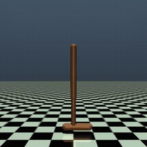
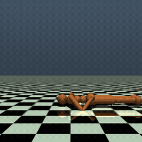
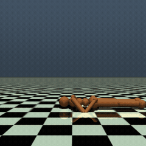
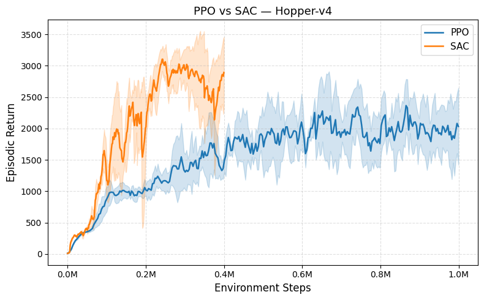
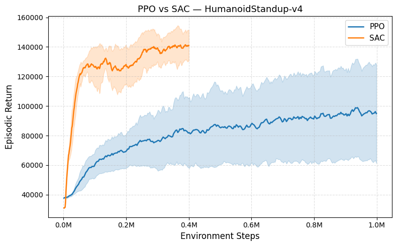
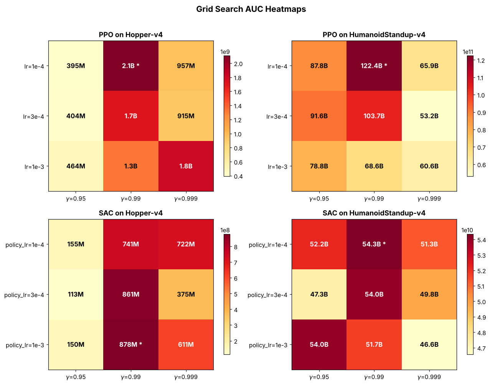

# On-Policy vs Off-Policy RL for Continuous Control: PPO vs SAC on MuJoCo

A head-to-head comparison of **Proximal Policy Optimization (PPO)**, which is on-policy, and **Soft Actor-Critic (SAC)**, which is off-policy, on two MuJoCo continuous-control tasks:

- **`Hopper-v4`**: a one-legged robot that has to learn to hop forward without falling.
- **`HumanoidStandup-v4`**: a 17-DoF humanoid that has to get up from lying on the ground.

Both agents are implemented in PyTorch. For each one we ran a 3×3 hyperparameter grid search, picked the best configuration by area under the learning curve, and then re-trained it on 3 seeds.

<table>
  <tr>
    <th></th>
    <th>PPO</th>
    <th>SAC</th>
  </tr>
  <tr>
    <td><b>Hopper-v4</b></td>
    <td></td>
    <td></td>
  </tr>
  <tr>
    <td><b>HumanoidStandup-v4</b></td>
    <td></td>
    <td></td>
  </tr>
</table>

<sub>Rollouts of the final seed-1 policies, downsampled for the README. Full-resolution GIFs for all three seeds are in <a href="notebooks/GIFs"><code>notebooks/GIFs/</code></a>.</sub>

---

## Key findings

- **SAC is much more sample-efficient.** On both tasks SAC gets to higher returns in **400k** environment steps than PPO does in **1M**.
- **On Hopper**, SAC reaches an episodic return of about **3,000** within ~250k steps. PPO levels off at about **2,000**.
- **On HumanoidStandup**, SAC climbs to about **125k** return within the first ~100k steps and ends around **140k**. PPO improves slowly to about **95k**, and its spread across runs is much wider.
- **γ = 0.99 was the best discount factor in all 4 grid searches.** γ = 0.95 was consistently the worst on Hopper, because a short horizon doesn't reward the long-term balance that hopping needs.
- **PPO is more sensitive to hyperparameters than SAC.** Across its 9 configurations, PPO's AUC varies by roughly 5× on Hopper and 2.3× on HumanoidStandup. SAC's HumanoidStandup grid stays within about ±8%.

---

## Results

### Final multi-seed comparison: Hopper-v4

Best configuration from the grid search, 3 seeds, mean ± 1 std (EMA smoothing 0.9):



### HumanoidStandup-v4

Learning curves averaged over the 9 grid-search configurations (seed 1), so the shaded area shows spread across hyperparameters rather than across seeds:



### Grid search

Each cell is the **area under the learning curve** (trapezoidal integral of episodic return over environment steps) for one configuration, with a single seed. `*` marks the best configuration in each panel.



| Algorithm | Environment | Search space | Best config |
|---|---|---|---|
| PPO | Hopper-v4 | `learning_rate` ∈ {1e-4, 3e-4, 1e-3} × `gamma` ∈ {0.95, 0.99, 0.999} | lr = 1e-4, γ = 0.99 |
| PPO | HumanoidStandup-v4 | same | lr = 1e-4, γ = 0.99 |
| SAC | Hopper-v4 | `policy_lr` ∈ {1e-4, 3e-4, 1e-3} × `gamma` ∈ {0.95, 0.99, 0.999} | policy_lr = 1e-3, γ = 0.99 |
| SAC | HumanoidStandup-v4 | same | policy_lr = 1e-4, γ = 0.99 |

> PPO and SAC were trained for different budgets (1M and 400k steps), so compare AUCs within an algorithm, not across algorithms.

---

## What we implemented

The training loops, networks, replay buffer and logging come from the course skeleton, which is based on [CleanRL](https://github.com/vwxyzjn/cleanrl). The core update rules are our implementation:

### PPO ([`agents/ppo.py`](agents/ppo.py))

| Function | What it does |
|---|---|
| `compute_gae` | Generalised Advantage Estimation with a backward recursion: δₜ = rₜ + γV(sₜ₊₁)(1−dₜ) − V(sₜ), Aₜ = δₜ + γλ(1−dₜ)Aₜ₊₁ |
| `compute_ratio` | Importance ratio π_θ(a\|s) / π_old(a\|s), computed in log space |
| `compute_policy_loss` | Clipped surrogate objective: −E[min(rₜAₜ, clip(rₜ, 1−ε, 1+ε)Aₜ)] |
| `compute_value_loss` | MSE between the critic and the GAE return targets |

Architecture: separate actor and critic MLPs (64-64, tanh), a state-independent log-std, observation and reward normalisation, 2048-step rollouts, 10 epochs × 32 minibatches.

### SAC ([`agents/sac.py`](agents/sac.py))

| Function | What it does |
|---|---|
| `compute_q_target` | Soft Bellman target: r + γ(1−d)·[min Q_target(s′, a′) − α log π(a′\|s′)] |
| `compute_actor_loss` | E[α log π(a\|s) − min(Q₁, Q₂)(s, a)] |
| `compute_alpha_loss` | Automatic entropy tuning: −E[log α · (log π + H_target)] |
| `soft_update` | Polyak averaging of the target networks: θ_target ← τθ + (1−τ)θ_target |

Architecture: a tanh-squashed Gaussian actor and twin Q-networks (256-256, ReLU), a 1M replay buffer, batch size 256, τ = 0.005, and automatic tuning of α.

---

## Repository structure

```
agents/
  ppo.py                      # PPO agent + training loop
  sac.py                      # SAC agent + training loop
notebooks/
  plot_results.ipynb          # learning curves (mean ± std over runs)
  render_policy.ipynb         # load a saved model.pt and render a GIF
  compare_grid_search.py      # ranks grid-search runs by AUC
  heatmap_grid_search.py      # draws the AUC heatmaps
  GIFs/                       # full-resolution rollouts of the final policies
assets/                       # images used in this README
output/                       # training artefacts (git-ignored)
```

---

## Getting started

**Requirements:** Python 3.10 (`>=3.10,<3.11`). [uv](https://docs.astral.sh/uv/getting-started/installation/) is recommended.

```bash
git clone https://github.com/mammadmammadov/On-Policy-vs-Off-Policy-Reinforcement-Learning-for-Continuous-Control.git
cd On-Policy-vs-Off-Policy-Reinforcement-Learning-for-Continuous-Control
uv sync
```

If you use pip instead:

```bash
pip install -r requirements/requirements-mujoco.txt
```

> **Note:** cloning downloads about 400 MB of full-resolution GIFs. Add `--depth 1` to the clone command to skip the history, or delete `notebooks/GIFs/` if you don't need them.

### Training

All hyperparameters are CLI flags (through [`tyro`](https://github.com/brentyi/tyro)). Run with `--help` to see them all.

```bash
# PPO
uv run python agents/ppo.py --env-id Hopper-v4 --seed 1 --total-timesteps 1000000

# SAC
uv run python agents/sac.py --env-id Hopper-v4 --seed 1 --total-timesteps 400000
```

Each run writes to `output/{env_id}/{algorithm}/{timestamp}_seed{seed}/`:

```
config.yaml   # hyperparameters used
returns.npy   # (global_step, episodic_return) pairs
model.pt      # network weights (+ observation normalisation stats for PPO)
```

### Reproducing the final runs

Add `--final-run` to save to a fixed path, `output/{env_id}/{algorithm}/final_run/seed{seed}/`, which the plotting notebook picks up:

```bash
for seed in 1 2 3; do
  uv run python agents/ppo.py --env-id Hopper-v4 --seed $seed --final-run \
      --learning-rate 1e-4 --gamma 0.99
  uv run python agents/sac.py --env-id Hopper-v4 --seed $seed --final-run \
      --policy-lr 1e-3 --gamma 0.99 --total-timesteps 400000
done
```

For `HumanoidStandup-v4`, use `--learning-rate 1e-4 --gamma 0.99` for PPO and `--policy-lr 1e-4 --gamma 0.99` for SAC.

### Analysing results

```bash
cd notebooks
uv run python compare_grid_search.py      # rank grid-search configs by AUC
uv run jupyter notebook                   # open plot_results.ipynb / render_policy.ipynb
```

If you're using VS Code and the `.venv` kernel doesn't appear, run `uv run jupyter notebook --no-browser` and connect through **Select Kernel → Existing Jupyter Server**.

---

## Authors

- **Mammad Mammadov** ([@mammadmammadov](https://github.com/mammadmammadov))
- **Kyra Ann D’Ignazio** ([@KyraDignazio](https://github.com/KyraDignazio))

## Acknowledgements

This project was completed as pair coursework for the Reinforcement Learning course at the University of Edinburgh. The skeleton code (environment wrappers, training loops and notebooks) was provided by the course staff and is adapted from [CleanRL](https://github.com/vwxyzjn/cleanrl).

### References

- Schulman et al., [*Proximal Policy Optimization Algorithms*](https://arxiv.org/abs/1707.06347), 2017
- Schulman et al., [*High-Dimensional Continuous Control Using Generalized Advantage Estimation*](https://arxiv.org/abs/1506.02438), 2015
- Haarnoja et al., [*Soft Actor-Critic Algorithms and Applications*](https://arxiv.org/abs/1812.05905), 2018
- Huang et al., [*CleanRL: High-quality Single-file Implementations of Deep Reinforcement Learning Algorithms*](https://github.com/vwxyzjn/cleanrl), JMLR 2022
